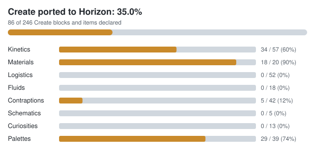

# Create for Horizon, in Rust

A from-scratch Rust rewrite of [Create](https://github.com/Creators-of-Create/Create) for
[Horizon](https://github.com/horizon-rust/horizon), the Rust reimplementation of Minecraft: Java Edition 26.3.
Horizon has no Java runtime, so Create's jar cannot run there; this ports its rules to Horizon's native mod API.

It is written on Horizon's **trait API** (named hook points with versioned contracts), not on source mixins, so it
is not pinned to one Horizon commit.

## Progress



<!-- progress:start -->
| Area | Done | Total | |
|---|---:|---:|---:|
| Kinetics | 51 | 57 | 89% |
| Materials | 18 | 20 | 90% |
| Logistics | 26 | 52 | 50% |
| Fluids | 18 | 18 | 100% |
| Contraptions | 33 | 42 | 79% |
| Schematics | 0 | 5 | 0% |
| Curiosities | 11 | 13 | 85% |
| Palettes | 39 | 39 | 100% |
| **All** | **196** | **246** | **79.7%** |
<!-- progress:end -->

Every block and item registered in Create's `AllBlocks.java` and `AllItems.java` counts once, under the section
it is registered in (a dyed set like the 16 seats counts as one). It counts as done once `content/` declares it.
That measures breadth, not depth: a declared block can still be missing behaviour listed below. Redraw the chart
and this table after adding blocks:

```bash
python tools/progress.py
```

## What works so far: the kinetics core

| Block | Behaviour |
|---|---|
| Shaft | Passes rotation along its axis |
| Cogwheel | Shaft along its axis; reverses a small cogwheel beside it |
| Large Cogwheel | Drives a diagonal small cogwheel at twice the speed, reversed; meshes with a large one on another axis at a corner |
| Gearbox | Four shafts: the one opposite the input is reversed, the side ones turn |
| Creative Motor | Makes 16 RPM by default, with 16,384 su of capacity per RPM |
| Hand Crank | Generates rotation when turned by hand |
| Water Wheel | Generates rotation from nearby flowing water |

Also: Andesite Alloy, recipes, loot tables and a creative tab. Right-click with the Wrench to turn a kinetic block
to its next axis or step a Creative Motor through 16, 32, 64, 128, 256 RPM and the same in reverse.
Sneak-right-click to remove a kinetic block and recover it in Survival.

Network rules follow Create's `RotationPropagator`: the fastest generator sets a network's speed, a block asked for
two speeds at once or for more than 256 RPM breaks, and a network with more stress than capacity stops. Nothing in
this slice costs stress yet; the accounting is there for the machines that will.

### Depot

Right-click the top of a Depot with an item to put the whole stack on it; right-click the top again, with anything
or nothing in hand, to take the stack back (`SharedDepotBlockMethods.onUse`). The item slides in from the side the
player faces and settles in the centre, as Create's does. The stack is saved in the block entity's one item slot and
drops when the block is broken; the sneak-wrench picks the Depot up. Its logic is in `native/api/src/depot.rs`.

Belts ending at it hand their items on, items landing on it are caught, hoppers feed and empty it, and a press
above presses what it holds, putting extra results in eight output slots drawn in a ring (Belts II, below).

Not yet: funnels, upright and package items. A block item's model is told apart from a flat
one by whether the item names a block, not by its model's `gui3d` flag.

### Mechanical Belt

Click a shaft with the Mechanical Belt (`create:belt_connector`, six dried kelp), then a second shaft on the same
axis, closer than 20 blocks (`BeltConnectorItem.canConnect`): level and across the shafts' axis for a flat belt, one
block up for each block along for a sloped one, straight above for a vertical one, and two upright shafts for a
sideways one; sneak-click to forget the first. The belt turns with the shafts at its ends and at any shaft it was laid through. It moves at
RPM / 480 blocks a tick (`BeltBlockEntity.getBeltMovementSpeed`).

Drop items on it and each stack (up to its maximum size) rides as one, keeping a block from the one ahead
(`BeltInventory.tick`). At the end, an open block lets it fly off as an item entity (`eject`); a block whose face
towards the belt is full holds it 0.45 blocks short, and the stacks behind queue up (`Ending.BLOCKED`). An empty hand
takes the stacks off the block clicked. Breaking a block drops its Belt Connector, a shaft where it had a pulley, and
everything the belt carried; the rest of the belt goes too, leaving shafts at the pulleys. Rules and tests are in
`native/kinetics/src/belt.rs`, the hooks in `native/api/src/belt.rs`.

A belt ending at another belt, a depot, a basin or an upright saw hands its items on (`Ending.INSERT`), a press
over a belt stops each item and presses it one at a time, and casings and dye can be put on (Belts II, below).

The belt's texture scrolls with its speed and shows its dye, and an andesite casing draws as andesite (all through
Horizon's UV shift, `Host::draw_terrain_model`, API 564; not yet checked in game).

Belts III: sloped, vertical and sideways belts. Items ride a slope as they ride a flat belt (tilted on it, up or
down a block for each block along, handing on and flying off at the ends along the slope); processors, funnels and
tunnels still work on flat belts only, as in Create. A vertical or a sideways belt only turns (it carries nothing, as
`BeltBlock.canTransportObjects` says), and casings go on every slope. Players and mobs standing on a turning belt
are carried along it and up and down slopes (below); sneaking or flying players stay put. The belt's outline and
collision follow Create's `BeltShapes`, a staircase on a slope, so a person walks up one.

Entities are pushed, not moved: Horizon gives a server mod velocity (`entity_push` for a mob, a message that makes a
player's client push them, as the Fan does) and no `Entity.move`, so an entity eases up to the belt's speed over a
few ticks. Not carried: the pull towards the belt's line, Slowness on mobs, and the cardboard and diving boots
exceptions; the belt slicer (Belt Connector on a belt, Wrench) isn't ported. Unplayed: type-checked and unit-tested
only. Not yet: fans over the belt and upright items. The rest of a broken belt goes one block a tick, not
all at once, and only a player's break drops its items (an explosion loses them). The first shaft is remembered per
player rather than on the item, with no outline shown.

### Machines and blocks added as modules

Everything below was written from Create's source and passes the unit tests, the type-check against Horizon,
the content build and the native build. An in-game test on 2026-11-15 (MCP-driven, `create-dev`) found the
content mod loading with no errors and every module below doing its main job: encasing, clutch and gearshift
on redstone, chain drives and the adjustable gearshift's ratio, the gauges, milling, crushing, fan pushing,
pulling and washing, basin and mixer (unheated and heated brass), burner fuel and Blaze Cakes, ore drops and
the building blocks. Not tested yet: mobs in crushing wheels, the fan on players, the nozzle's air, the
stressometer under load, food, zinc generation. A second test the same day found wave 2 working: tanks and
their windows, pipes and the pump, the drill, both saws, the press over a basin, belt and depot, belt hand-off
and hoppers on a depot, and the Blaze Burner's head in every lit state. Fixed after it, not yet re-tested: a
bucket on a tank also poured water beside it or filled twice, and the saw had no log recipes. Not tested yet:
chutes, funnels and steam (wave 3). Each module's own file
(`native/api/src/machines/<name>.rs`, `tools/content/<name>.py`) lists its known differences from Create at
the top. [MODULES.md](MODULES.md) explains the layout.

| Module | What it adds |
|---|---|
| Transmission | Andesite and Brass Encased Shafts and Cogwheels (casing on a shaft, wrench to toggle ends), Clutch, Gearshift, Encased Chain Drive, Adjustable Chain Gearshift, Speedometer, Stressometer |
| Millstone | Mills items with Create's 47 milling recipes; hoppers in and out, right-click to collect |
| Crushing Wheels | Two wheels make a controller that crushes items (55 crushing recipes, milling as fallback) and hurts mobs |
| Encased Fan, Nozzle | Air current that pushes and pulls items, mobs and players; washing and haunting (34 recipes) with Create's catalysts; smoking and blasting from copies of vanilla's 9 smoking, 73 smelting and 25 blasting recipes (lava burns every item that nothing smelts and that is not fire resistant, as Create's does); damage and effects on entities. Unplayed |
| Basin, Mechanical Mixer | Basin with item slots, fluid tanks and spout output; mixer with Create's mixing recipes and heat requirements |
| Blaze Burner | Fuel, Blaze Cakes, heat levels, capturing a Blaze, the lit burner |
| Materials | 44 items (ingots, sheets, nuggets, crushed ores, foods, Precision Mechanism...), zinc ore with world generation, storage blocks, the five casings |
| Fluid Tank, Pipes, Pump | Tanks up to 3 wide and 32 high with Create's windows, the Creative Fluid Tank, buckets and bottles; fluid and glass pipes with their arms, rims, drains and junction casings (drawn by the block entities, as Create's `PipeAttachmentModel` does); a pump moving fluid through branching pipes (it pulls behind and pushes in front, flipped with the wrench, as in Create); honey and chocolate as fluids with buckets |
| Mechanical Drill | Breaks the block in front at Create's speed for its hardness, with the crack shown; hurts entities |
| Mechanical Saw | Sideways: breaks blocks and fells whole trees (Create's `TreeCutter`). Upright: cuts items dropped on it or carried in by belts with `create:cutting` and stonecutting recipes, and hands results on |
| Belts II | Compacting with the press over a basin; the press over a belt and a depot; belt hand-off; depot output slots and hoppers; belt casings and dye |
| Belts III | Sloped, vertical and sideways belts with their models, scroll, shapes and casings; items riding slopes; players, mobs and minecarts carried by a turning belt (pushed, not moved) |
| Chutes, Funnels | Chute and Smart Chute (items fall, fans push them up, hoppers and belts feed them); Andesite and Brass Funnels taking from and putting into the block behind, and on belts and depots as belt funnels; filters set by sneak-clicking with an item |
| Andesite and Brass Tunnels | A casing over a belt block (it puts a casing on the belt if there is none) that takes the shape of what is beside the belt: straight, T, cross, or a window between tunnels and funnels (the Wrench closes and opens a window). Flaps swing as items pass. The Andesite Tunnel splits one item off a stack to each side output (belts, depots, funnels). The Brass Tunnel takes whole stacks and gives them out by its mode (split, forced split, round robin, forced round robin, prefer nearest, randomize, synchronize inputs) across the group of tunnels side by side, with a filter on each side; an empty hand takes back what the group holds. Sneak-click the top steps the mode, sneak-click a side with an item sets that side's filter. Unplayed: type-checked and unit-tested only |
| Steam | The boiler on a Fluid Tank, heated by Blaze Burners and fed water by pipes, with its gauge; the Steam Engine turning a Powered Shaft; the Steam Whistle and its extensions, pitched by size |
| Hose Pulley | Lowers a hose by RPM / 512 blocks a tick (4 su per RPM) until it meets a solid block, and drains the body of fluid at its end (breadth first through connected sources, a bucket at a time, from the top, the farthest first, up to 128 blocks away) or fills the space there with a bucket of what a pipe pushes in (lowest and nearest cell first). A body of 10,000 or more blocks of water or lava is infinite: never drained, and it swallows fills. Pipes and pumps reach it on its pipe side like a tank (1,500 mB inside). Honey and chocolate are placed and drained as their liquid blocks. The goggles show the infinite-supply hint. Known differences: the searches aren't saved over a reload, no fluid ticks are scheduled after a drain or fill, it doesn't turn to a shaft or pipe beside it when placed, the coil doesn't scroll. Unplayed |
| Spout, Item Drain | The Spout fills items on a belt or depot below it from its tank (`create:filling` recipes, buckets, bottles); the Item Drain empties items brought by belt, funnel or hand into its tank |
| Valves, Smart and Encased Pipes | Fluid Valve opened by rotation; copper and dyed valve handles turn it by hand; Smart Fluid Pipe with a fluid filter (sneak-click with an item); a fluid pipe encased with a copper casing |
| Small kinetics | Weighted Ejector (throws items and entities along Create's arc to a target picked with the item), Turntable, Cuckoo Clock and Mysterious Cuckoo Clock, Large Water Wheel, Wooden and Metal Brackets on shafts, cogwheels and pipes |
| Deployer | Uses its held item on the block or entity two in front (USE), or attacks and mines (PUNCH, toggled with the Wrench); over a belt or depot it applies Create's 167 deploying and 7 item-application recipes, polishes with Sand Paper in its hand, and does the deploying steps of a sequenced assembly; the hand and pole are drawn moving |
| Sand Paper, Red Sand Paper | Hold the right mouse button for 32 ticks with Rose Quartz in the other hand, or lying on the floor where you look: it becomes Polished Rose Quartz (`create:sandpaper_polishing`) and the paper wears by one of 8. The Deployer does the same on belts and depots. Polished Rose Quartz is what the Electron Tube and the Rose Quartz Lamp need, which opens the brass tier's crafting. Unplayed: type-checked and unit-tested only |
| Sequenced assembly | An item in the middle of an assembly is its transitional item (Incomplete Precision Mechanism, Unprocessed Obsidian Sheet) with a progress bar and a tooltip that lists the next steps. The Deployer, Mechanical Press, Mechanical Saw and Spout each do the step of their kind on belts and depots (and the press and saw on the ground and the saw blade), in the recipe's order, looping as many times as it says; the last step's item is one of the recipe's results by weight. In: the Precision Mechanism (gold sheet, cogwheel, large cogwheel and iron nugget, five times, which the Mechanical Arm needs) and the Sturdy Sheet (obsidian dust, lava from a Spout, two presses). The Track's is left out (no Track yet). Unplayed |
| Mechanical Arm | Picks up from inputs and puts down into outputs selected by clicking blocks with the arm in hand (within 5 blocks): belts, depots, ejectors, funnels, chutes, basins, Blaze Burners, deployers, millstones, crushing wheels, the upright saw, campfires, composter, jukebox and respawn anchor; round robin, forced round robin or prefer-first (Wrench steps it); redstone locks it; a record in a jukebox point makes it dance. As in Create, chests and vaults are reached through a funnel. Unplayed |
| Mechanical Crafter | Wrench-join crafters into a grid (click the edge of a face), turn the pointing with the Wrench on the front, items in by hand, funnel, chute, Mechanical Arm, Deployer or hopper (one item to each crafter in reading order), a Crafter Slot Cover to leave a hole. A full grid, or a redstone pulse, passes the items along the arrows to the last crafter, which crafts (crafting-table recipes and Create's `create:mechanical_crafting`) and hands the result to the belt, depot, chest or basin it points at, or throws everything out. The items and the result are drawn moving along. Vanilla shaped and shapeless crafting recipes are baked into the content (Horizon gives a mod none to read), so a data pack's changes to them aren't seen; no connected textures. Unplayed |
| Storage blocks | Item Vault (merges up to 3 wide and 3 times as long, 20 stacks a block; chutes, funnels and comparators see the whole vault), Creative Crate (endless supply of the item it's clicked with), Smart Observer, Threshold Switch |
| Engineer's Goggles | `create:goggles`, worn in the head slot (right-click to swap, drawn on the head by its `head` display model) with Create's recipe. With them on, looking at a Create block draws Create's tooltip box right of the crosshair (`GoggleOverlayRenderer`, words from Create's language file): every rotating block's stress impact or capacity at its speed, Speedometer and Stressometer readings, Fluid Tank and boiler status (level, size, water, heat, su given), Spout and Item Drain fluid, Basin contents, Chute fans and item, Deployer mode and item, Analog Lever strength, Steam Whistle pitch, Steam Engine and Powered Shaft capacity, Piston Extension Pole length. Without goggles it still warns "Overstressed" and "Speed Requirement", and hints for an arm with no targets, a bearing to update, a full Deployer, and why a bearing or piston did not assemble. Clicking a Mechanical Arm with the goggles puts them on it. Unplayed: type-checked and unit-tested only |
| Redstone parts | Redstone Link (frequency set by clicking each half with an item), Analog Lever, Pulse Repeater, Pulse Extender and Pulse Timer (the Wrench on a side steps the delay), Powered Latch and Toggle Latch, Rose Quartz Lamp |
| Flywheel | A brass wheel on a shaft axis, drawn on the shaft it sits on. It turns with the network and keeps turning after the power goes (each tick it closes 1/64 of the gap to the shaft's speed, as Create's does); no stress of its own. Recipe: 8 brass ingots round a shaft |
| Sequenced Gearshift | A casing with a shaft out of each end that runs a list of up to five instructions (turn by an angle, turn to move a piston, pulley or gantry, delay, await a redstone pulse, end), each at the input's speed forward or back, normal or double, when redstone starts it; the input end is the one the rotation comes in by, the output turns by the instruction's modifier and stands still in a delay, a wait and when idle. The comparator reads the instruction running. Edited with clicks (Settings, below) |
| Rotation Speed Controller | A shaft through a casing that, under a large cogwheel across it, drives that cogwheel (and whatever it meshes with) at its target speed, -256 to 256 RPM, as long as its own shaft turns, at any speed. The output costs stress out of the input's generators, as one network (Settings, below) |
| Contraption Controls | A panel with a button and a dial, facing the player: a click turns it off and on (the button sinks, the dial turns half way round), redstone power turns it off, and an item from `create:contraption_controlled` sets the filter. It keeps its state and filter in Create's keys, but nothing reads them yet: what it switches, the actors of a moving contraption, isn't ported |
| Display Link, Display Board, Nixie Tubes | Display Link: reads the block it sits on and writes text to a sign, a lectern, a row of Nixie Tubes or a Display Board up to 64 blocks away; click the target with the link in hand, then place it. Sources: Speedometer (RPM), Stressometer (bar, percent, su, capacity, remaining), Cuckoo Clock (time of day, stopwatch), Smart Observer (item count, item list, fluid amount, fluid list), Threshold Switch (fill level), belts, depots and weighted ejectors (item names), Seats (rider's name), a vanilla Target block (redstone power) and Nixie Tubes. Type of information, display option, label and start line are set by clicks (below). Display Board: a flap display on a 30 RPM cogwheel that joins into boards up to 32 wide and tall, shows lines of text on flaps that spin before they settle, and takes a name tag (a line), a dye (its colour), a glow ink sac and an empty hand (clears a line). Nixie Tubes: sixteen colours, two glowing digits showing redstone strength, or text from a name tag or a link along a row of tubes; a dye recolours the whole row |
| Building blocks | 364 blocks: metal ladders, bars, scaffolding and doors, copper shingles and tiles, glass and windows, 14 stone types in every pattern |
| Girders, Seats, Copycats | Metal Girders that join into beams and poles (placed, extended, toggled with the Wrench, `update_shape`), the Metal Girder Encased Shaft that carries rotation, 16 Seats a player sits on (a marker entity and `/ride`; a dye recolours), Copycat Step and Panel that take a block as their look (drawn squashed into the shape, not cropped). Unplayed: type-checked and unit-tested only; each module's header lists its differences |

Goggles' known differences from Create (`native/api/src/machines/goggles.rs`, `native/kinetics/src/rules/goggles*.rs`): the box slides in as Create's does but its alpha fade, which Create's code throws away, isn't drawn, and the offset and colours of Create's client config are constants; the Brass Tunnel's group of held stacks isn't sent to clients, so it has no tooltip; the Mechanical Arm's "no targets" hint has none of Create's five ticks of warmup; the Blaze Burner takes no goggles (not an `IHaveGoggleInformation` in Create either, and its goggled model isn't done); a generator turned faster by another generator shows its capacity at the network's speed, not at its own; a click on the arm with goggles may also equip them on the player's head on the client (Horizon predicts an equippable's use); the overlay shows to a spectator and a value box doesn't hide it (there are none); the icon is always the goggles. The words are read from the package (`assets/create/goggles/lang.json`, copied from Create's jar by `tools/goggles_assets.py`) and vanilla's language file.

Display Link clicks, in place of Create's screen (`display_link.rs`): right-click steps the type of information among those the block it reads offers; the Wrench on the face the link looks out of steps the line it starts writing at, on any other face the source's option (display mode, time format, number format); a name tag sets the label; sneak-right-click with an empty hand clears it; the Wrench sneaking picks it up. The Display Link, Display Board and Nixie Tubes have not been played: type-checked and unit-tested only. Known differences from Create: only the sources of blocks this port has (no boiler, scoreboard, death count, enchanting power, tunnel, train, elevator, package or factory gauge sources); text is plain and the flaps' colours are one per line; a Display Link reading a redstone or nixie source and a Display Board's joins are polled (a few ticks, up to half a second for joins) rather than driven by block updates; the lines a link wrote first on a sign or lectern are remembered in memory, not saved; a Nixie Tube has no waterlogging and a cube hit box; a Display Board placed against another does not take its facing; the flap spin and its sounds are worked out from the game time the text changed (the same on every client) and are not Create's per-client random.

Sand Paper and sequenced assembly's known differences from Create (`native/api/src/machines/sand_paper.rs`,
`sequenced.rs`; the rules are `native/kinetics/src/rules/sandpaper.rs` and `sequenced.rs`): Create takes the item to
polish into the paper when the use starts (`SAND_PAPER_POLISHING`) and gives it back if the use is let go; Horizon
can't change the held stack from a use hook, so nothing is taken until the 32 ticks are over, when the item is looked
for again (the other hand, or on the floor where you look) and polished if it is still there, so letting go early
costs nothing and the paper doesn't show what it polishes. The use starts only with something to polish, but a client
shows the eating pose for the click until the server's answer. No item particles; the paper's sound is played on
Create's schedule from the use tick; it does not scrape oxidised copper or take wax off (`useOn`; a Deployer with an
axe does). An item's assembly progress is a Horizon component (`create:sequenced_assembly`: recipe id, step, progress),
read on a client for the bar and tooltip only if the server sends it (untested). The Track recipe, the `create:track` and
the sleepers it needs are not ported. Only deploying, pressing, cutting and filling steps run (all of Create's have one
of these).

Flywheel, Sequenced Gearshift, Rotation Speed Controller and Contraption Controls' known differences from Create
(`native/api/src/machines/flywheel.rs`, `sequenced_gearshift.rs`, `speed_controller.rs`, `contraption_controls.rs`; the
rules are `native/kinetics/src/rules/` of the same names, and `Joint::Sequenced` and `Joint::SpeedController` in the
solver): none has a stress impact (`CStress.setNoImpact`), so the goggles' table needed nothing. Unplayed: type-checked
and unit-tested only.

- **Flywheel**: the wheel's chase and turn are worked out from the game time and where it stood when the speed last
  changed, so a client that arrives sees it where it really is (Create's client starts from standing still).
- **Sequenced Gearshift**: Create sends each instruction's target down the network (`SequenceContext`) so a bearing,
  piston, pulley or gantry stops at exactly that angle or distance; here nothing downstream hears it, so a turning
  instruction lasts the ticks it needs, rounded up (Create adds 2 ticks it later trims), and the output may turn up to
  a tick too far. Create counts an interrupted instruction's progress at the input's speed whatever the modifier; here
  it is at the output's. The input is the end the network reaches first (a generator's side); an idle or waiting
  gearshift passes nothing on the other end. Redstone is read each tick but acts only when the signal changes. The
  Wrench doesn't turn it (see Settings): sneak-place it, or place it again, for another axis. No `TransformableBlock`
  (it isn't rotated by a moving structure) and no ComputerCraft peripheral.
- **Rotation Speed Controller**: the output only goes from the controller to the cogwheel (Create's `getConveyedSpeed`
  also lets a driven cogwheel power the controller's shaft); the cogwheel is one more generator in its network, so a
  faster motor on the output side wins and two against each other jam. The output side's stress comes out of the
  input's capacity and, if it is more, stops both sides. The bracket and the axis under a cogwheel are fixed from the
  server's tick and the placement hook, and Create's `PlacementHelper` (right-click the controller with a large cogwheel)
  is not here.
- **Contraption Controls**: nothing reads the block yet; Create's Ponder scene for it plays on a block that does
  nothing. The filter is set by clicking with an item of `create:contraption_controlled` and cleared with a sneaking
  empty hand. No waterlogging, no `open` or `virtual` states and no elevator floor display.

Broad gaps across these modules:

- No vanilla crafting, smelting, smoking or blasting recipe can be read by a mod, so the mixer doesn't do
  shapeless crafting. (The Mechanical Crafter bakes the shaped and shapeless crafting recipes of the
  prepared game data, 1,202 of them, as `create:crafter_baked_*` recipes:
  `tools/content/_crafter_recipes_gen.py`; the fan bakes the smelting, smoking and blasting ones as
  `create:baked_smelting`, `create:baked_smoking` and `create:baked_blasting`, and the items immune to
  fire as the tag `create:fan_fire_resistant`: `tools/content/_fan_cooking_gen.py`. These copies are
  temporary: drop them when the project moves to the new mod API's `recipe_for`. A data pack's changes
  to vanilla's recipes are not seen until then.)
- Copper shingles and tiles don't weather or wax, metal scaffolding has no collision, sliding doors swing
  like vanilla doors, and no connected textures are drawn.
- Redstone and neighbour changes are polled each tick rather than heard.
- Vanilla stonecutting recipes are baked into the saw's data (678 of them), and block hardness for the drill is a
  baked table: Horizon gives a mod neither. The wood cutting and concrete washing recipes Create writes at load
  time (`RuntimeDataGenerator`) are baked for vanilla's items.
- Honey and chocolate flow and pour, but Horizon draws a mod fluid as its template (water), and an empty bucket
  didn't pick them back up in the test.
- Tunnels (`native/api/src/machines/tunnel.rs` lists them all): their shape, sides and flaps follow the
  neighbours every 4 ticks rather than on each update, a tunnel closed with the Wrench stays closed, a
  tunnel breaks a few ticks after its belt loses its casing, and there is no item handler (a hopper or
  funnel can't put items into one or take from one), no goggle tooltip, no Display Link source, no
  connected top texture on Brass Tunnels in a group and no flap sound. The belt tells clients an item is
  held up at a tunnel (`at_tunnel`) instead of letting them work it out.
- A mod can't list another block's slots, so chutes and funnels read a container's saved items; the Smart Chute
  and Brass Funnel have no filter slot (sneak-click with an item instead).

### Contraptions

The engine that lifts a group of blocks out of the world, moves or turns it and sets it down
(`native/api/src/machines/contraption.rs` has the design; the rules are
`native/kinetics/src/rules/contraption.rs`), with the first blocks that use it:

| Block | Behaviour |
|---|---|
| Mechanical Piston, Sticky Mechanical Piston | With Piston Extension Poles behind it, takes the poles, a head and the line of blocks in front (and what slime, honey and attached blocks hold on to) and moves them along its facing by RPM / 512 blocks a tick, up to the length of its poles, until something is in the way or the rotation stops; the sticky one pulls the block in front back. A negative speed extends a piston facing east, as in Create; an empty hand assembles it, a slime ball makes a piston sticky |
| Piston Extension Pole, Mechanical Piston Head | The poles set the range; the head only exists on an extended piston |
| Mechanical Bearing | Takes the block in front of it and what holds to it, turns it about its axis at the speed of the shaft out of its back, and sets it down at the nearest right angle when the rotation stops, an empty hand clicks it, a wrench turns it or it is broken |
| Linear Chassis, Secondary Linear Chassis, Radial Chassis | Hold on to the blocks in a line (up to their range, on each sticky end) or in a ball (the radius around a radial one, through its sticky sides) when a structure gathers them. A slime ball or Super Glue on a side makes it sticky, a sneaking empty hand takes the glue off, the Wrench steps the range (Settings, below); the sticky sides turn with a rotating structure. Unplayed |
| Super Glue | Right-click a block, then another: the box between them is glued when the blocks in it hold together (one use of the glue's 99, free in Creative); sneak-click forgets the first corner; a left click takes off the glue you look at. Blocks in a glued box move together when a structure gathers one of them, and the structure takes the glue along and puts it back where it lands. The glue is saved in a level attachment (see the module's header) and shown with dust to whoever holds the glue. Unplayed |
| Windmill Bearing, Windmill Sail Frame, Windmill Sails (white and 15 dyes) | The Windmill Bearing is the Mechanical Bearing that makes the rotation: 1 RPM for each 8 sail blocks (wool and sails) in its structure, up to 16, 512 su per RPM, clockwise or the other way (the Wrench on a side of the bearing toggles it); it assembles by hand with nothing turning it and refuses fewer than 8 sails. A sail faces the way you look; a dye recolours it (again: the sail beside the click, then the whole plane), shears take the canvas off, a sail or frame used on a sail lays the next of a row. Unplayed |
| Gantry Shaft, Gantry Carriage | A carriage on a turning, unpowered gantry shaft takes what it holds and runs along the rail at RPM / 512 blocks a tick (0.49 at most) until the shaft's end, something in the way, the shaft gone or powered; redstone powers the whole line of shafts, and a powered shaft turns with the carriage instead. The shafts join into start, middle, end and single parts. An empty hand on the carriage asks it to start. Unplayed |
| Rope Pulley, Rope, Pulley Magnet | Takes what hangs from the magnet (or lowers the rope alone and picks up what it meets) and pays the rope out or in at RPM / 512 blocks a tick, drawn as it goes; sets the structure down and the rope back as blocks where it stops, reaches its length (384, or the world's floor) or meets something. Breaking a rope takes the rest of it. Unplayed |
| Portable Storage Interface, Portable Fluid Interface | A stationary interface links with one on a structure that stops facing it (in its cell or the next, not powered) and stands for all the structure's chests, barrels, shulker boxes and Item Vaults (items) or Fluid Tanks (fluids) while linked: funnels and chutes insert into and take from it, pumps and pipes fill and drain it. The structure is held still beside it (a stall the piston and the bearing, so the windmill, follow) and goes on once nothing has moved for 60 ticks (`psiTimeout`). Redstone keeps one from linking and lets go of one that has. The middle and the top come out as the link forms. Unplayed |
| Elevator Pulley, Elevator Contact | An empty hand on a turning pulley takes the cabin under it (exactly one horizontal contact in it) and makes the contacts in a line in front of that contact its floors; redstone on a floor's contact calls the cabin, which speeds up and brakes onto the floor, and the contact there powers while it stands. An empty hand again sets the cabin down. Unplayed |

A structure is saved in the controller's block entity in Create's layout (`Anchor`, `Blocks.Palette`,
`Blocks.BlockList`), is out of the world while it moves, and is drawn by the controller's block entity;
a reload resumes it. Known differences from Create: nothing collides with a moving structure (no one rides,
stands on or is pushed by it), blocks in it are drawn as their block model only, no actors, seats or
movement interactions, only the "move and place" mode, the Clockwork Bearing and the Cart Assembler are not
here, belts and the Creative Fluid Tank can't be moved (a Fluid Tank can, with its content, if the whole tank is in the structure; its multi-block `Controller` is kept relative to the structure), and a controller destroyed by an explosion loses its structure. A structure can be held still (the `Stalled` flag of the controller, only the piston and bearing honour it; the Portable Interfaces use it). Tested in
game (build `8d883ba`): extend and retract, sticky pistons and the slime ball, stopping at an obstacle, slime
structures, the bearing turning and setting down every way, save and reload mid-stroke, and breaking a
controller while it runs. The chassis, Super Glue, windmill and sails, gantry, Rope Pulley and Elevator Pulley
(branch `contraptions-rest`) are type-checked and unit-tested only: each module's header lists its own
differences. The ones worth knowing:

- **Chassis**: the range is the Wrench's stand-in for the scroll value, each chassis keeping its own (Create sets
  the whole group); the Wrench doesn't turn a chassis; no range outline, no connected textures.
- **Super Glue**: a glue is a box in a level attachment, not an entity, so nothing else can push or kill it; the
  corners come from the block clicked and the selection is shown with dust, not an outline; no glue in the off
  hand placing with a block; only the glue in the main hand is charged; the Depot and other blocks that take any
  click can take the glue's click before it does.
- **Windmill**: the structure turns at the network's speed, which is its own output unless a faster source drives
  the network; a Copycat Panel doesn't count as a sail.
- **Gantry**: the structure is kept by the gantry shaft the carriage started on (Create keeps an entity), so
  that shaft can't be moved and a shaft runs one carriage at a time; the carriage's wheels aren't drawn; no shaft
  placement assist; powering and a carriage losing its shaft are polled.
- **Rope Pulley**: no mirrored pulleys (several on one structure), no waterlogged rope, the world's floor is
  taken as -64 in the Overworld and 0 elsewhere, the coil doesn't scroll.
- **Portable Interfaces**: the structure's storage is chests, trapped chests, barrels, shulker boxes, Item Vaults and Fluid Tanks (no Creative Crate, Depot, Dispenser, Toolbox or another mod's container; a double chest is two storages); it is read and changed in the controller's saved structure, in position order; only pistons and bearings hold a structure still, so an interface on a gantry, rope pulley or elevator never links; the comparator reads nothing; a hopper beside the stationary interface can't reach the structure's items (Horizon's hoppers see only a block's own container), nor can the Mechanical Arm; the moving interface is drawn at rest, not reaching out; the top's yaw about its axis may differ from Create's.
- **Elevator**: no Redstone Contact in this port, so the cabin's contact is an Elevator Contact (creative only,
  and it drops itself); no floor screen, door controls, Contraption Controls or Display Link source; a contact
  doesn't light while it powers; the draw's orientation is unchecked.

### Curiosities (equipment)

Each module's header (`native/api/src/machines/<name>.rs`) lists its differences from Create in full.

| Item | What it does here |
|---|---|
| Toolbox (16 colours) | 8 compartments of 4 stacks, one kind of item each; a left click picks it up with its contents (`create:toolbox_inventory`), a dye recolours it (also a crafting recipe that keeps the contents), the Wrench picks it up too. **Stand-ins for the radial menu and screen:** a right click opens a 9 x 4 chest view (a column per compartment; items that don't belong are handed back on close); a sneak right click links the selected hotbar slot to a compartment (with a matching item in hand, again to unlink; with an empty hand it steps through the compartments), and the box keeps that slot at half a stack within 10 blocks. Links are not saved across a reload; no hopper or comparator access, no lid animation. Unplayed: type-checked and unit-tested only |
| Clipboard | Pages of checklist entries that the item carries and a block keeps, placed on a floor, wall or ceiling (sneak-click to place, left click or sneak-click to take it back with its pages), Create's recipe and clearing recipe. **Stand-in for the screen:** a right click writes the open page into the chat, and `/clipboard add\|check\|uncheck\|toggle\|remove\|edit\|page\|newpage\|removepage\|clear\|show` edits the clipboard in the main hand (else the placed one right-clicked last). No settings copying between blocks. Unplayed |
| Linked Controller | Right-click to take over the movement keys (W, S, A, D, Space, Shift: the default bindings only), right-click again to put it away; each held key transmits 15 on the frequency pair bound to it, as the player's block position, kept alive by a message every 5 ticks and dropped 30 ticks after the last. Right-click a Redstone Link with it, then press a key, to bind the link's two frequency items to that key (the bind shows as a HUD line). Create's recipe. **Not done:** the lectern placement, the manual frequency screen (sneak-click), the click sound and the moving buttons. Unplayed |
| Copper and Netherite Backtank, Diving Helmets and Boots | The backtank is a chestplate holding up to 900 air (the item bar; `create:backtank_air`) and a block that fills from rotation (1 to 5 air every 0 to 20 ticks by speed, 4 su per RPM, shaft from the top, the cogs turn), placed by using the item on a block and dropping with its air. A worn diving helmet lets the player breathe under water on the tank's air, one a second, with low and depleted warnings; netherite also drains a netherite tank in lava, and the full netherite set (helmet, netherite backtank with air, leggings, boots) cancels fire and lava damage. Diving boots pull the player down in water. Armour values and durability are Create's; the worn pieces look like iron and netherite armour (no Create armour layers or backpack model). No Capacity enchantment, no air overlay, no comparator, no boots jump or lava walking. Unplayed |
| Extendo Grip | Held in a hand it adds 3 blocks to the player's block interaction range (5 with one in each hand; the range base is set in the player's tick and put back), attacks with it knock back 2 more, and each block broken or placed wears it (200 uses; a worn Backtank pays 1 air instead, creative players pay nothing). Create's mechanical crafting recipe. Wear is written to a grip in the main hand only; hits don't wear it; no entity-reach fix, no arm animation. Unplayed |
| Potato Cannon | A right click fires one item of ammunition from the inventory (24 types in Create's table: damage, knockback, reload ticks, velocity, spray of 2 or 3, burning, potion effects, a bowl back from the stew) with the `create:potato_cannon` damage type; 100 durability, or 4 air from a worn Backtank. **Stand-in for Create's projectile entity:** a vanilla snowball carrying the ammunition as its item, whose impact the mod takes over. No spin, sticking, crop planting or block placing on a block hit, chorus teleport, zombie-villager cure, Power, Punch or Potato Recovery. Unplayed |
| Peculiar Bell, Haunted Bell | Bells on vanilla's bell block (rings when hit or powered) with Create's models; a peculiar bell placed over soul fire or a soul campfire becomes a haunted one (a Fan's haunting also makes one), and a player holding a haunted bell sees cyan dust at the spots within 3 blocks where a mob could spawn (free, solid floor, no block light). Not done: Create's own ring and sounds, the pulse's soul particles and outline, haunting by lighting soul fire under a placed bell. Unplayed: it isn't known whether the template's bell body draws over Create's model |

### Small leftovers

Ten small blocks and items; each module's header lists its known differences. Type-checked and unit-tested
only: none has been played yet.

| Item | What it does here | Differences from Create |
|---|---|---|
| Vertical Gearbox | Places a Gearbox on its side, lined up with a shaft beside it or across the player's view. Create's three recipes. | The block is lined up right after placing (a placement hook can't read neighbours). |
| Crushed Raw Osmium and the eight other compat crushed ores | Declared, tagged `create:crushed_raw_materials`, left out of the creative tab as Create hides them without the metal. Their crushing recipes read their own `c:` tags, so they work once something fills a tag. | `neoforge:conditions` is not evaluated: the `tag_empty` recipes are kept (an empty tag never matches) and the `mod_loaded` smelting, blasting and splashing ones are left out. |
| Placard | Wall, floor or ceiling plate. A click with an item sets what it shows; a click with a matching item (or one a Filter item held in it accepts) gives a 19 tick pulse with Create's sounds and dust; left-click takes the item back. | Stacks with components can be set in Creative only; no waterlogging; the signal is mirrored in a table the block entity fills. Create's display link doesn't target it either. |
| Desk Bell | A click rings it (`create:desk_bell`), powers it for 20 ticks and animates its plunger and bell. The Wrench turns it. | No elevator ring on contraptions (`BellMovementBehaviour`). |
| List Filter, Attribute Filter | Filter items, accepted by every place the port takes a filter item (below). | No screen: see **Settings**. Attributes `in_item_group` and the Package Filter are left out; the processing attributes read this port's recipes; `fluid_container` knows vanilla's buckets. |
| Tree Fertilizer | Right-click a sapling: it grows at once (a square of four for the dark oak, pale oak and the mega spruce and jungle). | Placed with `/place feature`, so room checks apply (the sapling is put back and the item dropped if the tree doesn't fit); no bees. Create's recipe needs another mod. |
| Crafting Blueprint | A thin plate block. Sneak-click with an item to set the recipe that makes it (again for the next recipe); a click crafts it from your inventory, sneaking with an empty hand until the ingredients run out (64 at most). Wrench clears it. | A block stands in for the entity (size 1 only), no menu, no overlay, recipes from the baked crafting tables (to drop for `recipe_for`), plain stacks only. |
| Minecart Coupling | Click one minecart and then another: they keep their distance and pull each other along; the Wrench removes the couplings. Drawn as a line. | Only the soft velocity step runs, no hard step or rail shape; couplings are a list saved with the level by entity id, so they don't survive a restart; no chain model. |
| Creative Worldshaper | Cuboid, sphere, cylinder, surface and cluster brushes; fill, place, replace, clear and overlay tools; placement merged, attached or inserted. | No screen, one size for every dimension, no Flatten tool, no patterns, the block to use is its default state. |

**Filter items** are accepted by: the Smart Chute, Brass Funnel and Brass Belt Funnel, Brass Tunnel (per side),
Deployer, Smart Observer, Threshold Switch, Mechanical Arm's funnel check, the Display Link's item count, the
Smart Fluid Pipe (a List Filter passes the fluids its buckets hold; an Attribute Filter passes none, as in Create)
and the Placard. Where a belt or depot calls the test while holding the world (a Smart Chute over a belt, a Smart
Observer over a belt), the attributes that ask the game (tags, recipes, placeable) don't match.

### Schematics

Five items and blocks; type-checked and unit-tested only (the rules' tests include that the anchor the
tools store matches the cells a cannon prints for every size, turn and mirror), none has been played yet. Schematic
files are Create's: vanilla structure `.nbt` files (gzip), kept in `<instance folder>/schematics/`.

| Item | What it does here | Differences from Create |
|---|---|---|
| Schematic And Quill | Right-click two blocks to select a box (outlined in blue), a third click saves it as `my_schematic.nbt` (then `my_schematic_1.nbt`...); `/schematic save <name>` saves under a name; sneak discards; `/schematic expand <n>` grows the box the way you look. | No name screen (the third click names it "My Schematic"), no selecting in the air, no Ctrl-scroll on a face, no entities or glue saved. |
| Empty Schematic | The ingredient and what the table writes onto. | None. |
| Schematic | Names a file. Right-click a block to put its footprint's centre there (again to move it), sneak-right-click to turn it a quarter turn about its centre; `/schematic rotate [cw\|ccw]`, `flip x\|z`, `move <x> <y> <z>`, `undeploy`, `info`, and `print` (Creative: places it at once). The hologram follows. | No tool belt, scrolling or edit screen. The hologram is translucent boxes in the blocks' map colours (outline in Create's blue), not the blocks' models; an unpositioned one shows the box it would fill. One `create:schematic` component instead of Create's `schematic_*` ones. |
| Schematic Table | Right-click opens a hopper-shaped menu: slot 1 takes an Empty Schematic (or a Quill or a Schematic), slot 2 gives the written one. `/schematic list`, then `/schematic write <number or name>` writes it. | No screen or upload (the Schematic names a file of the one folder), slots 3 to 5 unused, the menu doesn't check what goes in a slot, no hopper access. |
| Schematicannon | Right-click opens a hopper-shaped menu (1 Schematic, 2 the Empty Schematic comes out, 5 gunpowder; 3 and 4 unused). It prints a positioned Schematic in Create's order (rows east, then south, then up, fragile blocks last), one block per 10 ticks, 400 per gunpowder, taking items from containers beside it (chests, barrels, hoppers, shulker boxes, vaults, a Creative Crate beside it makes it free), skipping what is already right, pausing when an item or the gunpowder is missing. The cannon turns to its target, recoils and the block flies to its place; it dings when finished. Wrench: play or pause (sneaking picks it up). `/schematicannon status\|checklist\|play\|pause\|stop\|replace dont\|solid\|any\|empty\|skip on\|off\|protect on\|off` act on the cannon you clicked last. | No Material List printing (book slot), no entities, no belts (a belt is built by connecting shafts, so `create:belt` blocks are skipped; their shafts print), settings not copied onto the dropped item. Costs come from vanilla's data plus Create's special cases for this mod's encased shafts and cogwheels, belt funnels, blaze burners, pipes and nixie tubes (no copycat, bracket, backtank, clipboard or placard extras). Block entity data is printed only for Create's safe-NBT blocks and signs. States are turned by property name (facing, axis, rotation, sides, rails, stairs, doors, crafters), not each block's own `rotate`. |

### Settings

Create's value boxes (the scroll value, the option boxes) aren't ported yet. Where a block has one, a click
stands in for it, written the same way for each:

- the **Wrench** on the block steps the number (the chassis' range, 1 to 16 and round) or toggles the option
  (the windmill's direction, the Creative Motor's speed), and the new value is shown on the action bar;
- sneaking with the Wrench picks the block up, as everywhere else;
- an **item** in hand sets what it names (a filter), and an empty hand clears it;
- **Filter items** (`create:filter`, `create:attribute_filter`) have no screen. With the filter in the main hand,
  on a block that takes no filter or in the air: with a reference item in the other hand, a List Filter adds that
  item (or removes it if it is in the list; 18 at most) and an Attribute Filter adds the first attribute of that
  item it doesn't have yet (sneaking adds the opposite, "is not ..."); with the other hand empty, a click cycles
  the mode (List: allow, allow with data, deny, deny with data; Attribute: any, all, deny) and sneaking clears it.
  The filter is shown on the action bar and its lines under its name;
- the **Crafting Blueprint** is set by a sneaking click with the item to craft, and the **Creative Worldshaper**
  by sneaking right-clicks (empty off hand: brush, Wrench: tool, stick: size, paper: placement) and a left-click
  on the block to use.

Where Create's screen or value box had more to set than one click can:

- **Sequenced Gearshift** (its screen, `SequencedGearshiftScreen`): an empty hand clicked on the block moves a
  cursor over the program's fields (a sneaking one moves it back) and shows the program on the action bar with the
  field in brackets: `1: Turn by angle [90°] ->  2: End`. A slot has a type (turn by angle, turn to move a piston or
  pulley or gantry, delay, await a pulse, end), a value (angle in steps of 45, up to 360; distance 1 to 128 in steps;
  delay 10 to 600 ticks in steps) and a speed (`>>` double forwards, `->`, `<-`, `<<`). The Wrench steps the field under
  the cursor: forward on a face pointing the positive way (up, south, east), back on a face pointing the negative way
  (down, north, west). Slots after the first `End` are skipped; change an `End` to something else to add an
  instruction (five at most). Editing stops a running sequence, as saving the screen does.
- **Rotation Speed Controller** (its value box): the Wrench on a side steps the target speed up on a south or east
  face and down on a north or west one, through -256, -192, -128, -96, -64, -48, -32, -24, -16, -8, -4, -2, -1, 0, 1,
  2, 4, 8, 16, 24, 32, 48, 64, 96, 128, 192, 256; on the top or the bottom it turns the block. The default is 16.
- **Contraption Controls** (its filter slot): an item in `create:contraption_controlled` (a drill, saw, deployer, funnel,
  door, bell, campfire, dispenser, dropper) right-clicked on it sets the filter; a sneaking empty hand clears it; the
  Wrench turns it a quarter turn. A plain click toggles it, as in Create.
- **Schematic And Quill, Schematic, Schematic Table and Schematicannon** (their name screen, tool belt, upload screen and
  cannon screen): see the Schematics table above. In short: three clicks with the Quill save a box (`/schematic save
  <name>` to name it, `/schematic expand <n>` to resize); a Schematic is positioned by right-clicking a block and turned
  by sneak-right-clicking or `/schematic rotate|flip|move|undeploy|info|print`; the table is its menu plus
  `/schematic list` and `/schematic write <n>`; the cannon is its menu, the Wrench (play and pause) and
  `/schematicannon status|checklist|play|pause|stop|replace|skip|protect`.

### Ponder

Press **K** during gameplay to browse the library. To open a tutorial directly, hover over a supported
item in the inventory or Creative menu and hold **W**. **Esc** and **E** return to the previous
screen.

Use **A/D**, the left and right arrows, or the mouse wheel to change scenes. Click a keyframe marker
to seek, press **S** or **R** to replay, and press **Q** to identify blocks. The lower-right button
toggles Comfy Reading. **Space** pauses or resumes. Drag to orbit and use **Ctrl+scroll** to zoom.

The original index contains all 169 registered storyboards and 18 Ponder tags from Create 6.0.10.
The content build reads the original schematics, English captions, models, and Ponder 1.0.82 GUI
textures from the local Create JAR. In the index, **Horizon tutorials** opens the 12 tutorials
adapted to the mechanics in this port, and **All scenes** lists every storyboard.

What was checked in game (`create-dev`, native build `9f42064`): the index, a tag page and its
item grid, opening an original storyboard and a Horizon tutorial, timed captions with their pointer
lines, blocks sliding in, pause, replay, seeking by keyframe marker, next and previous scene, the
identify tooltip (Q), the "Up Next" box at the end, and Esc back out to the game. Holding W over an
item opened its scene from the Creative menu. Not checked in game: orbiting by dragging, Ctrl+scroll
zoom, Comfy Reading, and the scene slide when changing scenes (the test tool can't drag, hold a
modifier, or hold W for the game). They are written as the Ponder rules say.

The Rust player handles timed captions, block reveals and replacements, moving sections, camera
changes, rotation, outlines and lines, item demonstrations, and the Mechanical Press's stroke (the
head comes down in the mode the storyboard starts, at the press's own speed). Items without a block
or model in this port, and blocks Create draws with its own renderers that this port doesn't have,
show as a book icon in the grids and as a translucent gray block in a scene.

What the player does not do yet. `python tools/ponder_storyboards.py` prints the Java operations it
could not translate; the biggest groups are block entity data changes (water wheel planks, crafter
and fluid contents), the breaking cracks of the drill and saw scenes, mechanical
arm, deployer, bearing and pulley movement, train bogeys and stations, parrots and minecarts,
particles, funnel flaps, and belt items that are removed again. A scene using those plays without
that part. The hint boxes (`showControls`) draw only a small gold cross, not Create's mouse and
item icons.

### Not done, and known differences from Create

- Open pipe ends, the Clockwork Bearing, the Cart Assembler, trains and the rest of
  logistics. Schematics are in, with the differences listed in their section (the Schematicannon's
  Material List, entities and belts are missing).
- The Deployer, the storage blocks, the Mechanical Arm, the Mechanical Crafter, tunnels, the Display Link,
  Display Board and Nixie Tubes, girders, seats and copycats have not been tried in
  game. The Spout, Item Drain, valves, smart pipes, redstone parts and small kinetic blocks were (build
  `8d883ba`); the double-acting empty-hand clicks and the Rose Quartz Lamp comparator reading found there
  are fixed since but not re-tested. Their
  filters and settings use click stand-ins until Create's value boxes are ported, and redstone is polled
  every tick rather than heard.
- The Creative Motor's speed is set with the Wrench, not Create's scroll-value box.
- A network only includes loaded, ticking blocks: the part of a line in an unloaded chunk drops out.
- A speed change takes one tick to reach each block, and is not eased.
- The vertical gearbox item and waterlogging are missing.

All seven kinetic blocks rendered in `create-dev` on the native build. The Creative Motor, Hand Crank and
Water Wheel each drove a connected shaft in the in-game MCP test. See [HANDOFF.md](HANDOFF.md) for the results.

## Layout

```
content/              Horizon declarations, recipes, loot, and item definitions
native/
  horizon-mixin.toml  the native bundle
  kinetics/           create-kinetics: the rotation rules, no game dependency, unit-tested
  api/                the hooks that put create-kinetics in the game
    src/ponder/       Ponder's library, storyboard playback, and client hooks
tools/
  gen_content.py      writes Horizon declarations and item definitions
  build_content.py    imports Create artwork from a local JAR and builds create.hmod
  ponder_storyboards.py  regenerates the Ponder instructions from Create 6.0.10 source
  ponder_assets.py    packages Create's schematics, captions and Ponder textures from the local JAR
  check_native.sh     type-checks native/ against a local Horizon checkout
```

## Build and test

The rules, in seconds:

```bash
cargo test --manifest-path native/kinetics/Cargo.toml
```

The hooks against Horizon's real API (needs a Horizon checkout beside this folder, or its path as an argument;
the first run compiles Horizon's client library):

```bash
bash tools/check_native.sh
```

Build the content mod with Python 3.11 or newer, `cargo-horizon-mod`, and a local copy of
Create 6.0.10 for Minecraft 1.21.1 (NeoForge). On this machine the JAR is already in
Horizon’s `create-resources` directory:

```powershell
python tools/build_content.py "$env:APPDATA/horizon/horizon-mods/create-resources/create-1.21.1-6.0.10.jar"
Copy-Item content/target/horizon-mod/create.hmod "$env:APPDATA/horizon/instances/create-dev/horizon-mods/"
```

The builder uses `cargo-horizon-mod` from PATH or the local build under
`target/horizon-tools/debug/`. Use `--tool` to supply its path explicitly.

Build `native/` for the same instance with
`horizon-launcher native-build native --instance <instance> --trust-native-code --profile dev`. The first native build downloads
Rust and takes 20 to 30 minutes. Use a disposable instance: a world opened without the mod loses its blocks.

## Licence and credit

Code here is MIT. Create's gameplay rules are ported from Create's MIT-licensed source, credit to the Creators of
Create. Create’s original artwork is All Rights Reserved. The build reads models and textures from the local JAR
and packages them into a local `create.hmod`. Keep that generated package local.
